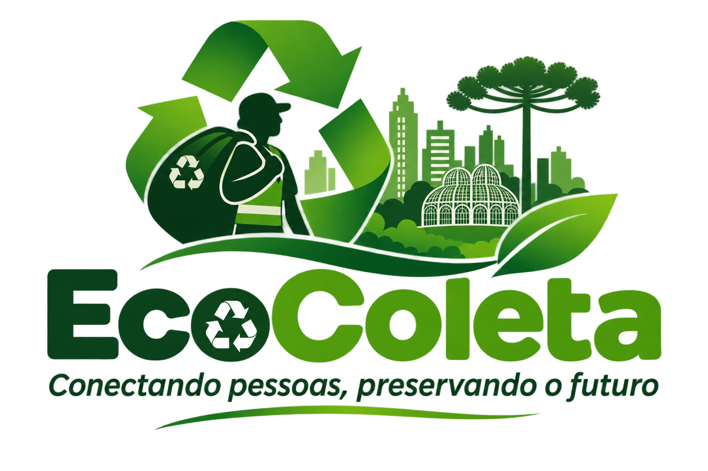

# EcoColeta

**Conectando pessoas, preservando o futuro.**

Portfólio público do Projeto Interdisciplinar I — Gestão da Tecnologia da Informação (2026.02).  
**Integrante informada:** Alessandra Ribas.  
**Instituição:** Instituto Federal do Paraná (IFPR) — Campus Pinhais.

## Conteúdo
- `index.html`: página pública do projeto.
- `assets/logo-ecocoleta.png`: logotipo e identidade visual.
- `docs/`: requisitos, arquitetura, instalação, evolução e resultados da pesquisa.
- `pesquisa/`: relatório em PDF e gráfico de indicadores.

## Identidade visual
A identidade utiliza tons de verde para comunicar sustentabilidade, reciclagem e conexão com a natureza, com elementos gráficos que remetem ao trabalho dos catadores e à paisagem urbana de Curitiba.

## Importante
O site distingue a proposta do que está efetivamente implementado. Os resultados da pesquisa são exploratórios (134 respostas) e não devem ser tratados como amostra representativa de toda a população. A validação direta com catadores e cooperativas ainda é necessária.

## Publicação
Consulte [`docs/instalacao.md`](docs/instalacao.md) para publicar gratuitamente com GitHub Pages.

