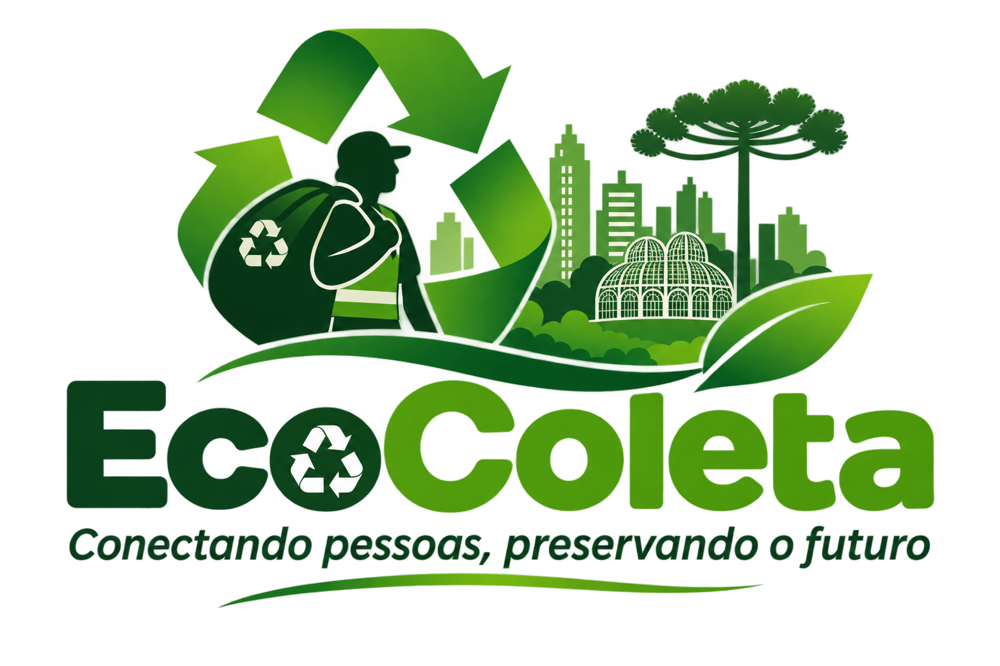

<!DOCTYPE html>
<html lang="pt-BR">
<head>
<meta charset="UTF-8">
<meta name="viewport" content="width=device-width, initial-scale=1">
<title>Evolução | EcoColeta</title>

</head>
<body>
<header>
  <nav>
    <a class="brand" href="index.html">EcoColeta</a>
    <a href="index.html">← Voltar ao projeto</a>
  </nav>
</header>
<main>
  <h1>Evolução e continuidade</h1>
  
Próximas etapas para validação e desenvolvimento do projeto.

  <h2>Próximas etapas sugeridas</h2>
  

    <ol>
      <li>Realizar entrevistas e observação com catadores e cooperativas.</li>
      <li>Validar prioridades e barreiras de acesso à tecnologia.</li>
      <li>Desenhar fluxos e protótipos de baixa fidelidade com participação dos usuários.</li>
      <li>Testar usabilidade e ajustar a linguagem e os processos.</li>
      <li>Implementar um MVP com cadastro, pontos e registro de coletas.</li>
      <li>Avaliar segurança, privacidade, acessibilidade e viabilidade de manutenção.</li>
      <li>Medir resultados com indicadores definidos em conjunto com os participantes.</li>
    </ol>
  

  <h2>Indicadores possíveis</h2>
  

    <ul>
      <li>Solicitações de coleta registradas e atendidas</li>
      <li>Tempo entre solicitação e atendimento</li>
      <li>Quantidade e tipos de materiais registrados</li>
      <li>Participantes ativos e pontos cadastrados</li>
      <li>Satisfação e facilidade de uso relatadas pelos catadores</li>
    </ul>
  

  
Os indicadores só devem ser divulgados após coleta e validação de dados reais.

  
<a class="inline" href="index.html">← Voltar à página principal</a>

</main>
<footer>
  
<strong>EcoColeta</strong> · Projeto acadêmico · GTI · 2026.02

</footer>
</body>
</html>
